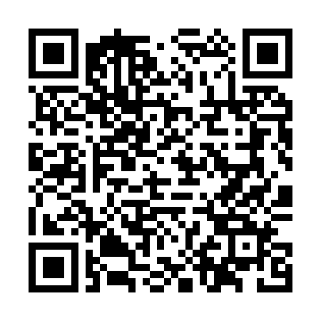

# 2DSync

Your saves. Your consoles. Anywhere.

<p align="center">
  <a href="https://github.com/MrQuackersHD/2DSync/releases/download/v0.1.0/2DSync.cia">
    
  </a>
</p>

<p align="center">
  <strong>Scan with FBI → Remote Install → Scan QR Code</strong><br>
  <a href="https://github.com/MrQuackersHD/2DSync/releases/download/v0.1.0/2DSync.cia"><strong>Download 2DSync.cia</strong></a>
  ·
  <a href="https://github.com/MrQuackersHD/2DSync/releases/download/v0.1.0/2DSync.3dsx">Download 2DSync.3dsx</a>
  ·
  <a href="https://github.com/MrQuackersHD/2DSync/releases/download/v0.1.0/SHA256SUMS">Checksums</a>
</p>

2DSync is a Nintendo 3DS homebrew application and a private server. It backs up save archives from games you own and copies those saves between 3DS-family consoles on custom firmware. It does not download, store, or sync game ROMs or installed title contents.

Supported consoles are the Nintendo 3DS, 3DS XL, New 3DS, New 3DS XL, 2DS, and New 2DS XL, running a current custom-firmware homebrew environment.

## What you get

- `3ds-client/` builds `2DSync.3dsx` and `2DSync.cia`.
- `server/` is a FastAPI service you host yourself.
- `docker/` runs PostgreSQL, the API, and Caddy.
- Portable tests cover save containers, conflicts, title filtering, and the HTTP API.

The CIA build is the one that can open other titles' save archives. The 3DSX build is for Homebrew Launcher and can manage backups that are already on the SD card, but save-archive access depends on the launcher's permissions. If every supported game reports that its save is unavailable, install the CIA with FBI.

## Install on a console

1. Scan the QR code at the top of this page with FBI, or download [2DSync.cia](https://github.com/MrQuackersHD/2DSync/releases/download/v0.1.0/2DSync.cia) and install that file.
2. Open 2DSync from the HOME Menu. Close any game before you sync it. 2DSync is the foreground application, so it is not writing into a game that is running.
3. Settings starts with the server at `https://fhs-app26.tail812c67.ts.net:10000`. That port is the public Tailscale address. TLS checking is off until you turn it on.

The QR code points at the CIA file itself: `https://github.com/MrQuackersHD/2DSync/releases/download/v0.1.0/2DSync.cia`. Generate a new one only after a replacement CIA URL returns the file:

```bash
python3 scripts/generate_fbi_qr.py "https://example.com/2DSync.cia" 2DSync-fbi.png
```

## Sync two consoles

1. On console A, open Sync Consoles and create an account. Write down the recovery code. It is shown once and it is not the sync code.
2. On console A, choose Show Sync Code. The code expires in ten minutes and works once.
3. On console B, choose Enter Sync Code.
4. On console A, open Pairing Requests and approve console B.
5. On either console, open the game and choose Upload Save.
6. On the other console, open the same game and choose Download Save. 2DSync stores a local backup before it replaces the save.

If the saves differ, the console shows Save Conflict Detected with the size and checksum of each side. Nothing is overwritten until you choose Keep Local Save, Download Cloud Save, or Upload Local Save.

If the only paired console is lost, enter the recovery code on a new console. The server rotates the recovery code and shows the new one. Revoke a console from Paired Consoles. Unpair removes the console you are holding.

## Build the 3DS app

Install [devkitPro](https://devkitpro.org/wiki/Getting_Started) with `3ds-dev`, which provides devkitARM, libctru, citro2d, makerom, and bannertool.

```bash
python3 scripts/gen_assets.py
make -C 3ds-client
```

Outputs:

- `3ds-client/2DSync.3dsx`
- `3ds-client/2DSync.cia` when `bannertool` and `makerom` are on `PATH`

Both outputs were produced in this development environment: the 3DSX with devkitARM, and the CIA with makerom after the RSF was accepted. They have not been launched on a console from this machine.

The title's unique ID is `0x2D59C`. Change `UniqueId` in `3ds-client/app.rsf` if that ID is already installed.

## Run the server

Development, SQLite:

```bash
cd server
python3 -m venv .venv
. .venv/bin/activate
pip install -r requirements.txt
cp .env.example .env
uvicorn app:app --host 127.0.0.1 --port 8000
```

Production is PostgreSQL behind HTTPS. See [docs/deployment.md](docs/deployment.md).

```bash
cp docker/.env.example docker/.env
# edit the password, pepper, and domain
docker compose -f docker/docker-compose.yml --env-file docker/.env up -d --build
```

API reference is [docs/api.md](docs/api.md). Interactive docs are at `/docs` on the server.

## Tests

```bash
make -C tests/host test
cd server && python3 -m pip install -r requirements.txt && python3 -m pytest -q
```

GitHub Actions builds the server tests, the portable C tests, and the 3DS binaries when devkitARM is available.

## Layout

```
3ds-client/     citro2d homebrew
server/         FastAPI
docker/         Compose and Caddy
common/         checksums, containers, conflict rules
docs/           deployment, saves, limits
scripts/        icon generation and the FBI QR helper
```

## Private data

Save files live on the console SD card under `sdmc:/3ds/2DSync/` and on the server under the storage directory. They are not part of this repository. Device tokens are random per console. Sync codes are not passwords. Set `TOKEN_PEPPER` yourself in production and do not commit `.env`.

## Further reading

- [Installation and build notes](docs/build.md)
- [Deployment, backups, and HTTPS](docs/deployment.md)
- [Save format and console compatibility](docs/save-format.md)
- [What is unsupported](docs/limitations.md)
